# Customer Support Ticket Classification System
## Comprehensive Technical Documentation & Architecture Guide

---

## 1. Executive Summary (The Plain-English Explanation)

### What Does This Project Do?
Imagine you work at a growing online company. Every day, thousands of customers write messages to customer support:
- *"I was charged twice on my credit card."*
- *"My package is 3 days late, where is it?"*
- *"The mobile app crashes every time I open the dashboard."*
- *"I forgot my password and cannot log in."*
- *"I returned the product last Monday, please give me my refund."*

If human agents have to read every message manually just to decide which department should handle it, customers wait hours or days. 

This project solves that exact problem using **Machine Learning**. It takes historical support tickets, learns the vocabulary and language patterns associated with each department, and automatically predicts where any **new, incoming ticket** belongs in milliseconds—along with a **confidence score**.

---

## 2. Real-World Motivation & Industry Value

| Challenge Without AI | Solution With This ML System |
| :--- | :--- |
| **Manual Triage:** Humans spend hours categorizing tickets. | **Instant Routing:** Tickets are classified in under 5 milliseconds. |
| **Human Error:** Misrouted tickets bounce between teams. | **Consistency:** Model applies learned objective patterns. |
| **Spikes in Volume:** Support desks get overwhelmed during holidays. | **Zero Overhead:** Machine learning handles infinite ticket spikes. |
| **Slow SLA Resolution:** Critical bugs wait behind billing issues. | **Priority Routing:** Technical issues go directly to engineering. |

---

## 3. End-to-End System Architecture

The complete pipeline operates across two distinct phases: **Training (Offline)** and **Inference (Real-Time)**.

```mermaid
flowchart TD
    subgraph Phase 1: Training Pipeline
        A["Raw Data (tickets.csv)"] --> B["Data Validation & Cleaning"]
        B --> C["Stratified Train/Test Split (80/20)"]
        C --> D["Training Set (120 samples)"]
        C --> E["Test Set (30 samples)"]
        D --> F["TF-IDF Vectorizer (Unigrams + Bigrams)"]
        F --> G["Logistic Regression Classifier"]
        G --> H["Evaluate on Test Set (Accuracy, F1, Precision, Recall)"]
        H --> I["Serialize Pipeline to models/ticket_classifier.joblib"]
        H --> J["Save Report to outputs/evaluation.txt"]
    end

    subgraph Phase 2: Real-Time Inference
        K["User Enters New Ticket Text"] --> L["Load Saved Pipeline (.joblib)"]
        L --> M["Transform Text via Learned TF-IDF Vocabulary"]
        M --> N["Calculate Class Probabilities (predict_proba)"]
        N --> O["Output: Predicted Category + Confidence Score"]
    end
```



---

## 4. Technology Stack & Design Decisions

### Why These Specific Technologies?

1. **Python 3.12:**
   - The industry standard for AI/ML development with extensive package support and clean syntax.

2. **pandas & NumPy:**
   - **Why:** Fast, tabular data structures. pandas validates column names (`text`, `category`), purges empty strings or null rows, and enforces deduplication.

3. **TF-IDF Vectorizer (`scikit-learn`):**
   - **Why not Deep Learning / LLMs?**
     - LLMs (e.g. GPT-4, BERT) require high latency, external API costs, GPU resources, and complex cloud dependencies.
     - For domain-specific classification on structured vocabularies, classical TF-IDF runs in less than 5 milliseconds, uses negligible memory, requires zero GPU, and is 100% reproducible offline.
   - **Unigrams + Bigrams:** By configuring `ngram_range=(1, 2)`, the model learns individual words (*"charged"*, *"refund"*) as well as crucial word pairs (*"charged twice"*, *"password reset"*, *"not received"*).

4. **Logistic Regression Classifier (`scikit-learn`):**
   - **Why:** Logistic Regression provides convex optimization (fast convergence, no local minima traps), resists overfitting on smaller text datasets, and natively produces calibrated class probabilities via the Softmax / Sigmoid function.

5. **scikit-learn Pipeline:**
   - **Why:** Combines preprocessing (`TfidfVectorizer`) and modeling (`LogisticRegression`) into a single object. This guarantees that test samples and new user inputs undergo the exact same transformation without data leakage.

6. **joblib Serialization:**
   - **Why:** Efficiently freezes the trained vocabulary, IDF weights, and model regression coefficients into a compact `.joblib` binary file, enabling instant loading without retraining.

---

## 5. Mathematical & Algorithmic Deep Dive

### 5.1 How TF-IDF Vectorization Works

Computers cannot read strings directly; they only understand numbers. TF-IDF transforms human words into numerical vectors using two components:

1. **Term Frequency (TF):**
   $$\text{TF}(t, d) = \frac{\text{Count of word } t \text{ in ticket } d}{\text{Total words in ticket } d}$$
   Measures how often a word occurs in a specific ticket.

2. **Inverse Document Frequency (IDF):**
   $$\text{IDF}(t) = \ln\left(\frac{1 + N}{1 + \text{DF}(t)}\right) + 1$$
   Where $N$ is total tickets, and $\text{DF}(t)$ is number of tickets containing word $t$.
   - Common words across all tickets (e.g., *"the"*, *"is"*, *"my"*) receive a very low IDF score.
   - Specific keywords (e.g., *"invoice"*, *"crash"*, *"courier"*) receive a high IDF score.

3. **Final TF-IDF Weight:**
   $$\text{TF-IDF}(t, d) = \text{TF}(t, d) \times \text{IDF}(t)$$
   The resulting vector is L2-normalized so ticket length does not bias predictions.

---

### 5.2 How Logistic Regression Predicts the Category

For a multi-class problem with $K=5$ categories, Logistic Regression learns a weight vector $w_k$ and bias $b_k$ for each class $k$:

1. **Linear Score (Logit):**
   $$z_k = w_k \cdot x + b_k$$
   Where $x$ is the TF-IDF vector of the ticket.

2. **Probability Estimation (Softmax):**
   $$P(\text{Category} = k \mid x) = \frac{e^{z_k}}{\sum_{j=1}^{K} e^{z_j}}$$

3. **Final Prediction:**
   $$\hat{y} = \arg\max_{k} P(\text{Category} = k \mid x)$$
   The maximum probability is reported as the **Confidence Score** (e.g., $0.49 = 49\%$).

---

## 6. Detailed File-by-File Code Walkthrough

```text
customer-support-ticket-classifier/
├── data/
│   └── tickets.csv                  # 150 customer tickets across 5 categories
├── models/
│   └── ticket_classifier.joblib     # Pretrained pipeline (vectorizer + classifier)
├── outputs/
│   └── evaluation.txt               # Stored metrics, report, and confusion matrix
├── src/
│   ├── train.py                     # Training routine
│   ├── evaluate.py                  # Evaluation & reporting routine
│   └── predict.py                   # Single ticket inference
├── main.py                          # Unified CLI entry point
├── requirements.txt                 # Dependencies
├── .gitignore                       # Git ignore rules
├── README.md                        # Project quickstart
└── DOCUMENTATION.md                 # In-depth architectural guide
```

### `data/tickets.csv`
Contains 150 balanced records (30 per category) with columns:
- `ticket_id`: Unique identifier (e.g. `TCK-1001`)
- `text`: Support request message
- `category`: Ground truth category (`Account`, `Billing`, `Delivery`, `Refund`, `Technical Support`)

### `src/train.py`
- `load_and_validate_data(filepath)`: Validates columns, trims text, removes empty entries, and eliminates duplicate tickets.
- `build_pipeline()`: Constructs `Pipeline([('tfidf', TfidfVectorizer(...)), ('classifier', LogisticRegression(...))])`.
- `train_and_evaluate()`:
  - Splits data using `train_test_split(..., test_size=0.2, random_state=42, stratify=y)`. Stratification ensures exactly 6 tickets per category in test data.
  - Fits the model on 120 training tickets.
  - Evaluates on 30 test tickets.
  - Serializes model to `models/ticket_classifier.joblib`.
  - Saves text report to `outputs/evaluation.txt`.

### `src/evaluate.py`
- Independent evaluation utility.
- Loads `models/ticket_classifier.joblib` and re-runs the stratified test split to verify performance metrics and regenerate the confusion matrix.

### `src/predict.py`
- Standalone inference engine.
- Contains `predict_ticket(text, model)`: Strips whitespace, vectorizes text, predicts class, and queries `predict_proba()` for confidence.
- Provides interactive loop and `--text` CLI argument handling.

### `main.py`
- Central controller connecting all workflows.
- Flags: `--train`, `--evaluate`, `--predict "<text>"`.
- Interactive Menu: When run with no flags (`python main.py`), displays a 4-option menu.

---

## 7. Model Performance & Evaluation Metrics

Evaluated on 30 unseen test samples (stratified 6 per class):

| Metric | Result | Meaning in Plain English |
| :--- | :---: | :--- |
| **Accuracy** | **86.67%** | 26 out of 30 unseen tickets were classified correctly. |
| **Macro Precision** | **86.95%** | When the model predicted a category, it was right ~87% of the time. |
| **Macro Recall** | **86.67%** | Out of all tickets belonging to a category, the model found ~87% of them. |
| **Macro F1-Score** | **86.32%** | The harmonic balance between Precision and Recall. |

### Per-Class Breakdown

| Category | Precision | Recall | F1-Score | Support |
| :--- | :---: | :---: | :---: | :---: |
| **Account** | 0.8571 | 1.0000 | 0.9231 | 6 |
| **Billing** | 0.8000 | 0.6667 | 0.7273 | 6 |
| **Delivery** | 1.0000 | 0.8333 | 0.9091 | 6 |
| **Refund** | 0.8571 | 1.0000 | 0.9231 | 6 |
| **Technical Support** | 0.8333 | 0.8333 | 0.8333 | 6 |

---

## 8. Real-Time Generalization on Completely New Tickets

The model was tested against 10 completely fresh, unseen tickets written outside of `tickets.csv`:

| # | Unseen Ticket Text | Predicted Category | Confidence | Semantic Validity |
| :-: | :--- | :--- | :-: | :-: |
| 1 | *"Someone changed my account email and I cannot access my profile."* | **Account** | 49.30% | Correct |
| 2 | *"I want to enable two factor authentication using Google Authenticator."* | **Account** | 30.26% | Correct |
| 3 | *"The payment amount on my credit card statement is incorrect."* | **Billing** | 49.25% | Correct |
| 4 | *"Can I change my subscription billing frequency from quarterly to annual?"* | **Billing** | 28.72% | Correct |
| 5 | *"The courier says my parcel was delivered but I never received it."* | **Delivery** | 42.01% | Correct |
| 6 | *"My package was shipped to the old address by mistake, can you reroute it?"* | **Delivery** | 35.29% | Correct |
| 7 | *"The product I purchased is damaged and I want my money returned."* | **Refund** | 30.66% | Correct |
| 8 | *"I returned the shoes a week ago, when will the refund hit my bank account?"* | **Refund** | 34.90% | Correct |
| 9 | *"The website freezes whenever I try to upload a document."* | **Technical Support** | 29.46% | Correct |
| 10 | *"I am getting an internal server error 500 when saving my dashboard."* | **Technical Support** | 43.46% | Correct |

---

## 9. Interview Preparation Guide for Freshers

When explaining this project during a technical interview, use the following talking points:

### 1. The 30-Second Elevator Pitch
> *"I built an end-to-end Customer Support Ticket Classification System in Python using scikit-learn and pandas. The system takes historical customer complaints, cleans and preprocesses the text, extracts n-gram features using TF-IDF, and trains a Logistic Regression classifier wrapped in a scikit-learn Pipeline. It achieves 86.67% accuracy across 5 categories, serializes the model to disk using joblib, and provides real-time CLI inference with probability confidence scores for newly incoming tickets."*

### 2. Common Interview Questions & Answers

**Q: Why did you choose Logistic Regression over a Deep Learning model like BERT or an LSTM?**
> *"For this use case, classical ML is the right engineering decision: it trains in seconds, runs inference in under 5 milliseconds on basic CPU hardware, requires no expensive GPU infrastructure or third-party API keys, and achieves ~87% accuracy on domain vocabularies. Deep learning would introduce unnecessary latency, complexity, and resource costs without significant benefit for this data scale."*

**Q: Why did you use `ngram_range=(1, 2)` instead of just unigrams?**
> *"Single words often lose critical context. For example, the word 'twice' alone does not indicate billing, but the bigram 'charged twice' strongly signals a Billing issue. Similarly, 'password reset' signals Account, and 'server error' signals Technical Support. Bigrams capture these multi-word semantic cues."*

**Q: Why was `stratify=y` used in `train_test_split`?**
> *"Stratified splitting ensures that the training and testing sets have the exact same class distribution as the original dataset. Without stratification on smaller datasets, random splitting might place 8 billing tickets in the test set and only 2 refund tickets, leading to biased and unreliable evaluation metrics."*

**Q: What is data leakage, and how did you prevent it?**
> *"Data leakage happens when information from the test set leaks into the training process—for example, if the TF-IDF vectorizer fits its vocabulary on the entire dataset before splitting. I prevented this by using a scikit-learn `Pipeline` and fitting the vectorizer strictly on `X_train`, then transforming `X_test` using the learned parameters."*

---

## 10. Operational Limitations & Production Roadmap

1. **Current Scope:**
   - Designed for Level 2 inference (on-demand command-line/interactive prediction).
   - Trains once on historical data; does not retrain automatically upon receiving a new ticket.

2. **Production Enhancements (Roadmap):**
   - **Confidence Threshold Routing:** Flag any ticket with confidence $< 0.30$ to a human triage queue.
   - **REST API:** Expose the model using a FastAPI microservice for integration with Zendesk, Jira Service Desk, or Freshdesk.
   - **Continuous Retraining:** Implement a weekly batch job to retrain the pipeline as support agents label new tickets.
